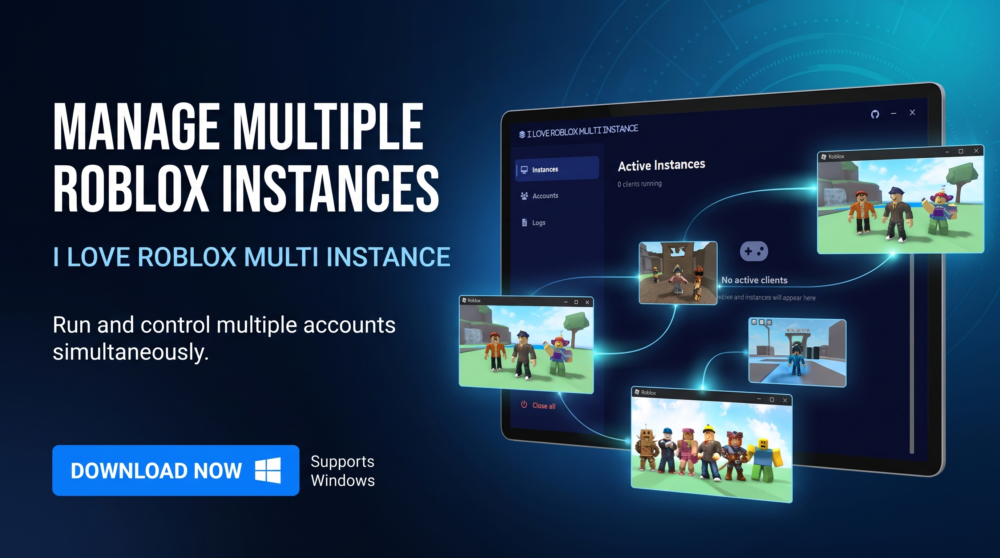

A Windows desktop manager for running multiple Roblox clients at the same time. It detects running Roblox instances, shows which user and game each one is in, lets you save accounts with encrypted `.ROBLOSECURITY` cookies, and launch them directly without logging in each time.

The application is a single Python file built with CustomTkinter, with a borderless custom window, animated transitions, and a background monitoring system.

---

## Table of Contents

- [Features](#features)
- [Requirements](#requirements)
- [Installation](#installation)
- [Running the Application](#running-the-application)
- [Project Structure](#project-structure)
- [Architecture Overview](#architecture-overview)
- [Module Reference](#module-reference)
- [Account Security](#account-security)
- [Network Requests](#network-requests)
- [Local File and Process Access](#local-file-and-process-access)
- [Known Limitations](#known-limitations)
- [Troubleshooting](#troubleshooting)

---

## Features

- **Instances view:** lists every running `RobloxPlayerBeta.exe` process with its PID, the Roblox username (resolved from the client's own log), the display name, the avatar headshot, and the current game or place.
- **Accounts view:** save accounts by pasting a `.ROBLOSECURITY` cookie. Cookies are validated against Roblox and stored encrypted with Windows DPAPI.
- **One-click launch:** creates an authentication ticket for a saved account and starts a new Roblox client with it.
- **Multi-instance support:** creates the `ROBLOX_singletonMutex` so several clients can run side by side.
- **Grid and list layouts** for saved accounts.
- **Close all** and per-instance kill buttons.
- **Notes view:** displays the notes file hosted in the `notcni/roblox-multi-instance` GitHub repository.
- **Borderless window** that still appears in the Windows taskbar with its own icon and minimizes correctly.
- **Animations:** fades, slides, hover transitions, a pulsing status dot, and a shake on invalid input.

---

## Requirements

### Operating system

- **Windows 10 or Windows 11 only.** The app depends on `ctypes.windll`, the Win32 API (through `pywin32`), and Windows DPAPI.
- The title font "Segoe UI Variable Display" is only present on Windows 11. On Windows 10 the app falls back to "Segoe UI" automatically.

### Python version

- **Python 3.10 or newer is recommended.** The code uses f-strings, `time.time_ns()`, and standard-library features available since Python 3.7, but the dependencies (CustomTkinter, Pillow, pywin32) currently target 3.10+.
- Development and testing were done on **Python 3.14**.

### Python dependencies

| Package | Purpose | Import name |
|---|---|---|
| `customtkinter` | Modern themed widgets on top of Tkinter | `customtkinter` |
| `psutil` | Finds Roblox processes and their open log files | `psutil` |
| `pywin32` | Win32 APIs: DPAPI encryption, window enumeration, mutex, window styles | `win32api`, `win32crypt`, `win32event`, `win32gui`, `win32process` |
| `Pillow` | Icon generation, avatar resizing and rounding | `PIL` |

### Standard library modules used

`base64`, `codecs`, `ctypes`, `io`, `json`, `math`, `os`, `queue`, `re`, `subprocess`, `sys`, `threading`, `time`, `tkinter` (including `tkinter.font`), `urllib` (including `urllib.request` and `urllib.error`), `webbrowser`. No extra installation is needed for these.

### Create a `requirements.txt`

```text
customtkinter
psutil
pywin32
Pillow
```

### External resources

- **Font Awesome 6.5.1 web fonts** are downloaded from cdnjs on first run and cached in `fonts/`. An internet connection is needed for the first launch. Without the fonts, icons render as empty boxes.
- **Roblox web APIs**, **GitHub**, and the **notes file** are used at runtime. See [Network Requests](#network-requests).

---

## Installation

1. **Install Python 3.10 or newer** from python.org. During installation, tick "Add python.exe to PATH".

2. **Create and activate a virtual environment** (recommended):

   ```bash
   python -m venv venv
   venv\Scripts\activate
   ```

3. **Install the dependencies:**

   ```bash
   pip install -r requirements.txt
   ```

   or directly:

   ```bash
   pip install customtkinter psutil pywin32 Pillow
   ```

4. **If `import win32crypt` fails after installing pywin32**, run the pywin32 post-install script once:

   ```bash
   python venv\Scripts\pywin32_postinstall.py -install
   ```

   The script may be in `venv\Scripts\` or in `venv\Lib\site-packages\pywin32_system32\` depending on your version. Run whichever one exists.

5. **Place the file** `main.py` in a folder of your choice. The app creates the `data/` and `fonts/` folders next to it on first run.

---

## Running the Application

```bash
python main.py
```

On first launch the app:

1. Downloads `fa-solid-900.ttf` and `fa-brands-400.ttf` into `fonts/` if they are missing.
2. Registers the fonts for this process only (not system-wide).
3. Creates `data/app.ico` and sets it as the window and taskbar icon.
4. Creates `data/accs/accounts.json` when you first save an account.

---

## Project Structure

```text
.
├── main.py                   # Entire application
├── requirements.txt          # Python dependencies
├── fonts/                    # Font Awesome fonts (auto-downloaded)
│   ├── fa-solid-900.ttf
│   └── fa-brands-400.ttf
└── data/
    ├── app.ico               # Generated application icon
    └── accs/
        └── accounts.json     # Saved accounts (cookies are encrypted)
```

---

## Architecture Overview

The app runs three kinds of execution context:

| Context | Class | Role |
|---|---|---|
| Main (UI) thread | `AppGUI` | Builds the window, runs the Tk event loop, and draws every widget. Only this thread touches Tk widgets. |
| Monitor thread | `Monitor` | Every `SCAN_INTERVAL` (2 s), scans processes and reads Roblox log files. Publishes a snapshot under a lock. |
| Resolver thread | `Resolver` | Works through a job queue to fetch usernames, avatars, and game names over HTTP, with a cache. |
| Worker threads | created ad hoc | Used for account authentication/launch and for downloading the notes, so the UI never blocks on the network. |

**Thread safety rule:** background threads never touch widgets directly. They call `AppGUI._post(fn, *args)`, which puts the call on a queue. The main thread drains that queue every 20 ms in `_pump()`.

**UI refresh:** `_sync_ui()` runs every 1 s on the main thread. It reads the monitor's latest snapshot and creates, updates, or removes `InstanceCard` widgets to match it.

---

## Module Reference

### Constants

#### Paths and external resources

| Name | Value / purpose |
|---|---|
| `FA_VERSION` | Font Awesome version used for the CDN download (`6.5.1`). |
| `FA_CDN` | Base URL for the Font Awesome web fonts on cdnjs. |
| `FONT_DIR` | `fonts/` folder next to the script. |
| `FA_FILES` | The two font files to download: solid and brands. |
| `DATA_DIR` | `data/` folder next to the script. |
| `ACCS_DIR` | `data/accs/`, where accounts are stored. |
| `ACCS_FILE` | `data/accs/accounts.json`. |
| `ICON_FILE` | `data/app.ico`. |
| `NOTES_URL` | Raw notes file in the `notcni/roblox-multi-instance` GitHub repository. |
| `GITHUB_URL` | Profile page opened by the GitHub button (`https://github.com/notcni`). |
| `ROBLOX_LOG_DIR` | `%LOCALAPPDATA%\Roblox\logs`, where the Roblox client writes its logs. |

#### Fonts and icons

| Name | Purpose |
|---|---|
| `FONT_SOLID`, `FONT_BRANDS` | Font Awesome family names. Replaced at startup with the names actually installed. |
| `FONT_UI` | UI font ("Segoe UI Variable Display", or "Segoe UI" as fallback). |
| `FONT_MONO` | Monospace font for usernames and the notes view (`Consolas`). |
| `ICON_*` | Unicode code points for Font Awesome glyphs (logo, GitHub, play, trash, etc.). |
| `APP_NAME` | Window title, logo text, and taskbar name (`ROBLOX MULTI INSTANCE`). |

#### Theme colors

| Name | Use |
|---|---|
| `BG`, `SIDEBAR_BG` | Main background and sidebar background. |
| `CARD_BG`, `CARD_BORDER`, `CARD_BORDER_HOVER` | Card surfaces and their borders (normal and hover). |
| `ACCENT`, `ACCENT_HOVER`, `ACCENT_SOFT`, `ACCENT_LIGHT` | Primary button, hover state, subtle highlight, and accent text. |
| `AVATAR_BG`, `HOVER_BG` | Avatar placeholder background and generic hover background. |
| `DANGER`, `DANGER_SOFT` | Destructive actions (kill, delete, errors) and their hover background. |
| `SUCCESS`, `SUCCESS_DIM` | Status dot and success messages, and the dim end of the pulse. |
| `TEXT`, `TEXT_SOFT`, `TEXT_MUTED`, `TEXT_DIM` | Four text tones from brightest to dimmest. |

#### Behavior and parsing

| Name | Purpose |
|---|---|
| `ROBLOX_PROCESS` | Process name to match: `robloxplayerbeta.exe`. |
| `SCAN_INTERVAL` | Seconds between process scans in `Monitor` (2.0). |
| `AVATAR_SIZE` | Avatar image size in pixels (56). |
| `CARD_HEIGHT` | Height of instance cards in pixels (110). |
| `FRAME_MS` | Animation frame duration in milliseconds (16, about 60 fps). |
| `GENERIC_TITLES` | Window titles that carry no useful information (e.g. "Roblox"). |
| `RE_PLACE` | Regex that extracts the place ID from `Joining game '...' place N`. |
| `RE_USERID` | Regex that extracts the user ID from log lines containing `userid`. |
| `BROWSER_UA` | User-Agent string sent with every HTTP request. |
| `FR_PRIVATE` | Windows flag for a font that is visible only to the current process. |

#### Win32 setup

| Name | Purpose |
|---|---|
| `GWL_EXSTYLE`, `WS_EX_APPWINDOW`, `WS_EX_TOOLWINDOW` | Extended window style values used to make the borderless window appear in the taskbar. |
| `SW_MINIMIZE` | `ShowWindow` command for minimizing. |
| `user32` | `ctypes.windll.user32`, with argument and return types declared for the functions used. |

### Animation and styling helpers

| Function | Description |
|---|---|
| `_rgb(color)` | Converts `#RRGGBB` to an `(r, g, b)` tuple. |
| `_mix(a, b, t)` | Linearly interpolates between two hex colors. `t` is 0 to 1. |
| `_ease(t)` | Cubic ease-out curve used by all animations. |
| `tween(widget, key, duration, step, done=None)` | Runs `step(eased_t)` on a timer over `duration` ms. Cancels any previous tween stored under the same `key` on that widget. |
| `fade_color(widget, option, target, duration=160)` | Smoothly changes a color option (e.g. `fg_color`, `text_color`) to `target`. Does nothing if already at that color. |
| `reveal(widget, option, start, target, duration=260)` | Sets a color to `start` and fades it to `target`. Used when cards appear. |
| `fade_window(window, duration=260, start=0.0, end=1.0)` | Fades a window's `-alpha` attribute. Used for the main window and dialogs. |
| `_tint(widget, bg, fg, duration=140)` | Fades a widget's background and text color together. Used for hover states. |
| `_outline(widget, active)` | Fades a card's border between normal and hover color. |

### Hover handling

| Function | Description |
|---|---|
| `_pointer_inside(widget)` | Returns `True` if the mouse pointer is over `widget` or one of its children. Prevents hover from flickering when the pointer moves onto a child widget. |
| `_tree(widget)` | Generator that yields a widget and all of its descendants. |
| `bind_hover(widget, enter, leave)` | Binds `enter` and `leave` callbacks to a widget and all of its children. `leave` runs only when the pointer has really left the widget. |

### Icon generation

| Function | Description |
|---|---|
| `build_app_icon(path)` | Draws a 256×256 rounded blue square with a three-layer diamond emblem using Pillow and saves it as a multi-size `.ico`. |

### Security and encryption

| Function | Description |
|---|---|
| `encrypt_data(data)` | Encrypts a string with Windows DPAPI (`CryptProtectData`) for the current Windows user and returns it as base64. |
| `decrypt_data(b64_data)` | Reverses `encrypt_data`. Returns an empty string if decryption fails (wrong user, wrong machine, corrupted data). |

### Roblox and system helpers

| Function | Description |
|---|---|
| `find_roblox_exe()` | Searches the three standard Roblox install locations (`%LOCALAPPDATA%`, `Program Files (x86)`, `Program Files`) for `RobloxPlayerBeta.exe` and returns its path, or `None`. |
| `fetch_auth_ticket(cookie)` | Gets a Roblox authentication ticket for a `.ROBLOSECURITY` cookie. First calls `POST auth.roblox.com/v2/logout` to obtain an `x-csrf-token`, then calls `POST auth.roblox.com/v1/authentication-ticket` and returns the `rbx-authentication-ticket` response header. Returns `None` on failure. |
| `get_auth_user(cookie)` | Calls `GET users.roblox.com/v1/users/authenticated` with the cookie. Returns the account's JSON (including `id` and `name`), or `None` if the cookie is invalid. |
| `download_font(filename)` | Downloads a font file from the CDN into `fonts/` if it is not already there. Writes to a `.part` file first, then renames it, so a failed download never leaves a broken font. Returns the path or `None`. |
| `register_font(path)` | Calls `gdi32.AddFontResourceExW` with `FR_PRIVATE`, which makes the font usable by this process only. |
| `load_fonts()` | Downloads and registers both fonts, then reads the installed font families to find the exact family names. Falls back to "Segoe UI" if "Segoe UI Variable Display" is not available. Runs before the window is created. |

### Network helpers

| Function | Description |
|---|---|
| `http_get(url)` | `GET` with `BROWSER_UA` and a 10 s timeout. Returns raw bytes. |
| `http_json(url)` | `http_get` followed by JSON decoding. |
| `fetch_user(user_id)` | `GET users.roblox.com/v1/users/{id}`. Returns `{"name", "display"}`. |
| `fetch_avatar_url(user_id)` | `GET thumbnails.roblox.com/v1/users/avatar-headshot`. Returns the image URL if the thumbnail is ready, otherwise `None`. |
| `fetch_game_name(place_id)` | Looks up the universe for a place (`apis.roblox.com/universes/v1/places/{id}/universe`), then the game name for that universe (`games.roblox.com/v1/games`). |
| `make_round_avatar(raw, size)` | Converts downloaded image bytes into a square RGBA image with rounded corners. Uses 4× supersampling for smooth edges. |

### Local Roblox detection

| Function | Description |
|---|---|
| `window_titles_by_pid()` | Enumerates visible top-level windows and returns a dict mapping process ID to window title. Used to show a game name when the log does not provide one. |
| `find_log_for_process(proc)` | Uses `psutil` to list files the Roblox process has open and returns the one that is a `.log` file inside `ROBLOX_LOG_DIR`. |

### Classes

#### `LogWatcher`

Reads a Roblox log file incrementally and extracts the user ID and place ID.

| Member | Description |
|---|---|
| `__init__(path)` | Stores the file path and sets up an incremental UTF-8 decoder. |
| `poll()` | Reads only the bytes added since the last call (tracked with `offset`), splits them into lines, and keeps any incomplete last line in a buffer. Sets `user_id` from the first `userid` match and updates `place_id` on each `Joining game` match. |

#### `Monitor` (thread)

Watches for Roblox clients.

| Member | Description |
|---|---|
| `run()` | Loop every `SCAN_INTERVAL` seconds: get visible window titles, find every `robloxplayerbeta.exe` process, attach a `LogWatcher` to new ones, poll each watcher, drop watchers for processes that have exited, and publish the snapshot `{pid: {title, user_id, place_id}}` under `self.lock`. |

#### `Resolver` (thread)

Fetches remote data without blocking the UI, and caches the results.

| Member | Description |
|---|---|
| `__init__()` | Creates the job queue, cache, pending set, and failure timestamps. |
| `request(kind, key)` | Queues a fetch for `("user" | "avatar" | "game", key)` unless it is cached, already pending, or failed within `RETRY_AFTER` (30 s). |
| `state(kind, key)` | Returns `"done"`, `"pending"`, or `"failed"`. |
| `value(kind, key)` | Returns the cached result, or `None`. |
| `run()` | Worker loop. Takes jobs from the queue, calls `_resolve`, and stores the result. Failures are recorded with a timestamp. |
| `_resolve(kind, key)` | Static dispatcher that calls `fetch_user`, the avatar pipeline, or `fetch_game_name`. |

#### `NavButton(ctk.CTkFrame)`

Sidebar navigation item with an animated accent bar.

| Member | Description |
|---|---|
| `__init__(...)` | Builds the icon, label, and indicator bar. Binds hover and click to the whole button. |
| `_enter()` / `_leave()` | Fade the background to the hover color and back. |
| `_grow_bar(target)` | Animates the height of the indicator bar to `target` (0 or 0.5). |
| `set_active(active)` | Updates colors and animates the indicator to show the active state. |

#### `InstanceCard(ctk.CTkFrame)`

One card per running Roblox client.

| Member | Description |
|---|---|
| `__init__(master, pid, on_kill)` | Builds the avatar, username, display name, game, status dot, and kill button. Fades the card in. Starts the pulse animation. |
| `_pulse()` | Sine-wave animation of the status dot, every 60 ms. Stops when the widget is destroyed. |
| `set_user(user_id, user, avatar, loading)` | Updates the username, display name, and avatar. Only changes the avatar image when the user ID changes. |
| `set_game(text, known)` | Updates the game label and fades its color depending on whether the name is known. |

#### `AccountCard(ctk.CTkFrame)`

One card per saved account.

| Member | Description |
|---|---|
| `__init__(master, acc_id, acc_data, on_launch, on_delete, resolver)` | Builds the avatar, name, delete button, and launch button. Starts loading the avatar if a user ID is stored. |
| `_load_avatar()` | Polls the resolver every 500 ms until the avatar is ready, then displays it. |
| `set_status(text, color)` | Shows a temporary status message (e.g. "Authenticating...") in place of the name. |
| `reset_status()` | Restores the account name. |

#### `AddAccountDialog(ctk.CTkToplevel)`

Borderless modal dialog for adding an account.

| Member | Description |
|---|---|
| `__init__(master, on_save)` | Centers the dialog over the main window, builds the form, fades it in, and grabs input focus. |
| `_entry(parent, placeholder)` | Creates a text entry whose border highlights on focus. |
| `_start_drag` / `_drag` | Let the user move the dialog by its title bar. |
| `_error(text)` | Shows an error message and shakes the dialog. |
| `_shake(step=0)` | Moves the dialog left and right in a short damped sequence. |
| `verify_and_save()` | Strips the cookie, validates it with `get_auth_user`, and falls back to the manual name if validation fails and a name was typed. Encrypts the cookie and calls `on_save`. |

#### `AppGUI(ctk.CTk)`

The main window.

**Startup and window management**

| Method | Description |
|---|---|
| `__init__()` | Creates the window, loads accounts, builds all views, starts the Monitor and Resolver threads, schedules the periodic jobs, and fades the window in. |
| `setup_mutex()` | Creates the named mutex `ROBLOX_singletonMutex` that Roblox checks for. Holding it is what allows multiple clients to run. |
| `_apply_taskbar_style()` | Adds `WS_EX_APPWINDOW` and removes `WS_EX_TOOLWINDOW` so the borderless window shows in the taskbar. Sets the icon. Hides and reshows the window so the style takes effect. |
| `minimize()` | Minimizes the window through the Win32 `ShowWindow` call on its parent handle. |
| `close_app()` | Stops the background threads, releases and closes the mutex, destroys the window, and exits. |
| `_start_drag` / `_drag` | Let the user move the window by its title bar or logo. |

**Asynchronous UI bridge**

| Method | Description |
|---|---|
| `_post(fn, *args)` | Queues a function to run on the main thread. Safe to call from any thread. |
| `_pump()` | Runs queued functions on the main thread, every 20 ms. |

**Layout builders**

| Method | Description |
|---|---|
| `_build_titlebar()` | Logo, GitHub button (opens the profile in the browser), minimize, and close. |
| `_icon_btn(parent, icon, command, ...)` | Creates a borderless icon button with a hover color. |
| `_build_sidebar()` | Navigation buttons (Instances, Accounts, Logs) and the Close all button. |
| `_build_content()` | Container frame where the views are placed. |
| `_build_instances_view()` | Header, client counter, scrollable list of instance cards, and the empty state. |
| `_build_accounts_view()` | Header, layout toggle (list/grid), Add Account button, and scrollable account list. |
| `_build_logs_view()` | Header and a read-only text box for the notes. |

**Navigation**

| Method | Description |
|---|---|
| `show_view(name, animate=True)` | Switches views with a short slide-in animation, updates the sidebar state, refreshes the accounts list when that view opens, and loads the notes the first time the view opens. |
| `_fetch_logs()` | Starts a worker thread that downloads `NOTES_URL` and posts the text to the UI. |
| `_set_logs_text(text)` | Writes the downloaded text into the notes box (main thread only). |

**Instance monitoring**

| Method | Description |
|---|---|
| `_sync_ui()` | Every second, makes the instance cards match the Monitor's snapshot. Adds and removes cards, updates usernames, avatars, and game names, and shows or hides the empty state. |
| `_game_text(info)` | Chooses what to show as the game name, in priority order: the name from the API, the window title (if not generic), `Place <id>`, or "Waiting in menu". |
| `kill_process(pid)` | Terminates a Roblox process, ignoring processes that have already exited or cannot be accessed. |
| `kill_all()` | Calls `kill_process` on every tracked instance. |

**Account management**

| Method | Description |
|---|---|
| `load_accounts()` | Loads `accounts.json` into memory. Starts with an empty set if the file is missing or invalid. |
| `save_accounts_file()` | Writes the in-memory accounts to `accounts.json`. |
| `open_add_account()` | Opens `AddAccountDialog`. |
| `add_account_entry(name, user_id, encrypted_cookie)` | Stores a new account under a nanosecond timestamp ID, saves the file, and refreshes the list. |
| `delete_account(acc_id)` | Removes an account from memory and from the file. The file is not securely wiped. |
| `toggle_view_mode()` | Switches between a single-column list and a two-column grid. |
| `refresh_accounts_ui()` | Rebuilds the account cards in the current layout, or shows the empty state. |
| `_account_card(acc_id)` | Finds the card widget for an account ID. |
| `_set_status(card, text, color, reset_after=None)` | Sets a card's temporary status and optionally restores the name later. |
| `_restore_status(card)` | Restores the card name, ignoring cards that have already been destroyed. |
| `launch_account(acc_id)` | Decrypts the cookie, then in a worker thread: gets an authentication ticket, finds the Roblox executable, and starts `RobloxPlayerBeta.exe --app -t <ticket>`. Reports each step on the card. |

### Entry point

```python
if __name__ == "__main__":
    load_fonts()
    app = AppGUI()
    app.mainloop()
```

`load_fonts()` runs before the window exists, so Tk can see the newly registered font families.

---

## Account Security

### How saved cookies are protected

1. **Input handling.** The pasted `.ROBLOSECURITY` value is stripped of surrounding whitespace. It is never written to the console or to a log. Only exception messages are printed, and those do not include the cookie.

2. **Validation.** `get_auth_user` sends the cookie once to `users.roblox.com` to confirm it is valid and to read the account's name and user ID. If the cookie is invalid, the user can still save the account with a manual name, but in that case the cookie is still stored and will fail at launch time.

3. **Encryption at rest.** The cookie is encrypted with **Windows DPAPI** (`CryptProtectData`) before it is written to disk. The app passes no optional entropy and no `CRYPTPROTECT_LOCAL_MACHINE` flag, so the key is tied to the **currently logged-in Windows user account**.
   - The stored value in `accounts.json` is base64 text. It is not readable as a cookie.
   - Another Windows user on the same machine cannot decrypt it.
   - Copying `accounts.json` to a different computer or a different Windows user makes it unreadable. Decryption then returns an empty string, and the card shows "Decryption Failed".

4. **Plaintext data that is stored.** Only the account's display name, Roblox user ID, and a timestamp-based account ID are stored in plain text. These are not secrets, but they do reveal which accounts you have saved.

5. **In memory.** The decrypted cookie exists in memory only while an authentication ticket is being requested. It is a local variable in `launch_account` and its worker thread. It is not cached or stored elsewhere.

6. **Launch flow.** The decrypted cookie is sent to `auth.roblox.com` to obtain a short-lived **authentication ticket**. That ticket is passed to Roblox on the command line with `-t`.

### What to be aware of

- **The `.ROBLOSECURITY` cookie gives full access to the Roblox account.** Anyone who has it can log in as that account. Treat it like a password.
- **Anyone logged into the same Windows account can run the app** and launch any saved account. DPAPI protects the file from other users and other machines, but not from the owner of the Windows session.
- **The authentication ticket appears in the process command line** of `RobloxPlayerBeta.exe`. Other programs running as the same Windows user can read it while the client starts.
- **Deleting an account** removes its entry from `accounts.json`, but the file system does not securely overwrite the old bytes.
- **Do not share or commit the `data/` folder.** Add it to `.gitignore`:

  ```gitignore
  data/
  fonts/
  ```

- **Keep a backup of nothing you cannot recreate.** Because the encryption key is tied to your Windows login, a reinstalled Windows account cannot read the old file.

---

## Network Requests

The application only sends requests to the hosts below. There is no analytics, telemetry, or crash reporting.

### Roblox

| Host | Method and path | When | Data sent | Data received |
|---|---|---|---|---|
| `auth.roblox.com` | `POST /v2/logout` | When launching a saved account | Cookie header | `x-csrf-token` response header |
| `auth.roblox.com` | `POST /v1/authentication-ticket` | When launching a saved account | Cookie header, CSRF token | `rbx-authentication-ticket` response header |
| `users.roblox.com` | `GET /v1/users/authenticated` | When saving an account | Cookie header | Account ID and name |
| `users.roblox.com` | `GET /v1/users/{id}` | For each detected client and saved account | User ID | Username and display name |
| `thumbnails.roblox.com` | `GET /v1/users/avatar-headshot` | For each detected client and saved account | User ID | URL of the avatar image |
| *(host from the thumbnail response, normally a Roblox image CDN)* | `GET` | After the avatar URL is returned | None beyond the request itself | Avatar image bytes |
| `apis.roblox.com` | `GET /universes/v1/places/{id}/universe` | When a client reports a place ID | Place ID | Universe ID |
| `games.roblox.com` | `GET /v1/games?universeIds={id}` | After the universe ID is known | Universe ID | Game name |

### Font Awesome

| Host | Path | When | Data sent |
|---|---|---|---|
| `cdnjs.cloudflare.com` | `/ajax/libs/font-awesome/6.5.1/webfonts/fa-solid-900.ttf` and `fa-brands-400.ttf` | Only on first run, when the font files are missing from `fonts/` | None beyond the standard request headers |

### GitHub

| Host | Path | When | Data sent |
|---|---|---|---|
| `raw.githubusercontent.com` | `/notcni/roblox-multi-instance/refs/heads/main/notes.txt` | When the Notes view is opened for the first time in a session | None beyond the standard request headers |

Clicking the GitHub icon in the title bar opens `https://github.com/notcni` in your default browser. This is a browser navigation, not a request made by the app itself.

### Request details

- Every HTTP request uses the `BROWSER_UA` User-Agent string and an explicit timeout (5 to 15 seconds).
- Cookie headers are sent only to `auth.roblox.com` and `users.roblox.com`.
- All hosts are HTTPS.
- Requests that fail are not retried immediately. Failed avatar and game lookups are retried after 30 seconds.

---

## Local File and Process Access

The app reads, but never modifies, the Roblox client's own files and processes:

- **Process list.** Every 2 seconds, the Monitor thread looks for processes named `robloxplayerbeta.exe`.
- **Open files.** For each Roblox process, `psutil` lists its open files. The app keeps only the `.log` file inside `%LOCALAPPDATA%\Roblox\logs`.
- **Log contents.** The app reads new bytes from that log file and looks for two patterns:
  - `userid` followed by a number, to identify the logged-in user.
  - `Joining game '...' place <number>`, to identify the place.
- **Window titles.** Visible top-level windows are enumerated to read their titles, which are used as a fallback game name.
- **Roblox executable.** The app searches the three standard Roblox install folders for `RobloxPlayerBeta.exe` when launching.

Nothing read from the log is sent anywhere. The user ID from the log is only used to request the username and avatar described above.

The app also creates a named mutex (`ROBLOX_singletonMutex`) in the current session. This is how multiple Roblox clients are allowed to run at once.

---

## Known Limitations

- **Windows only.** The app will not run on macOS or Linux.
- **Undocumented APIs.** Roblox's web endpoints are not officially supported for this purpose. Any change to them can break login, launch, or name resolution.
- **Log format dependency.** User and place detection relies on the wording of Roblox's log lines. A Roblox update that changes them will stop detection.
- **Internet needed on first run** to download the icon font. Without it, icons show as empty boxes.
- **Ticket exposure.** The authentication ticket is visible on the command line, as described in [Account Security](#account-security).
- **No automated tests.** The project has no test suite.
- **Terms of service.** Running multiple clients and launching accounts with stored cookies may conflict with Roblox's Terms of Use. Use it at your own risk.

---

## Troubleshooting

| Symptom | Likely cause and fix |
|---|---|
| `ModuleNotFoundError: No module named 'win32crypt'` (or another `win32*` module) | Run the pywin32 post-install script (see [Installation](#installation)). |
| `ValueError: 'width' and 'height' arguments must be passed to the constructor` | Update to the current version of `main.py`. Size arguments were removed from `place()` calls. |
| Icons show as empty boxes | `fonts/` is missing or the download failed. Check the internet connection and delete any `.part` file in `fonts/`, then restart. |
| Accounts show "Decryption Failed" | The file was created under a different Windows user or on a different computer. Delete the account and add it again. |
| Accounts show "Auth Failed" | The cookie has expired or been invalidated. Copy a fresh `.ROBLOSECURITY` cookie and add the account again. |
| Accounts show "Roblox not found" | Roblox is not installed in one of the standard folders. Install it, then launch again. |
| Instances show "Waiting in menu" or "Place …" | The client has not logged a place join yet, or the log format has changed. |
| Notes view says "Error loading notes" | No internet connection, or GitHub is unreachable. |
| Window does not appear in the taskbar | Make sure you are on Windows 10 or 11 and not running inside a remote desktop session that blocks the Win32 styles. |
